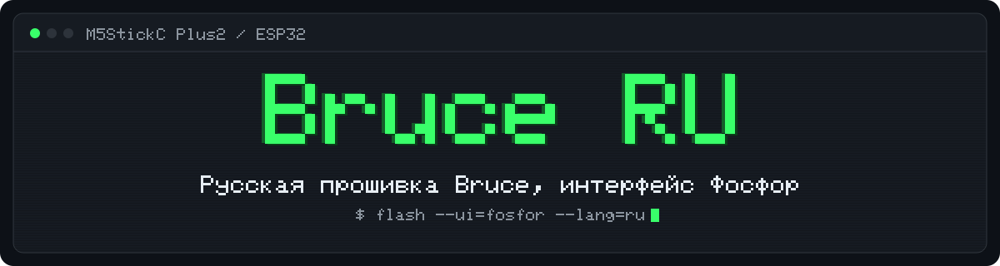
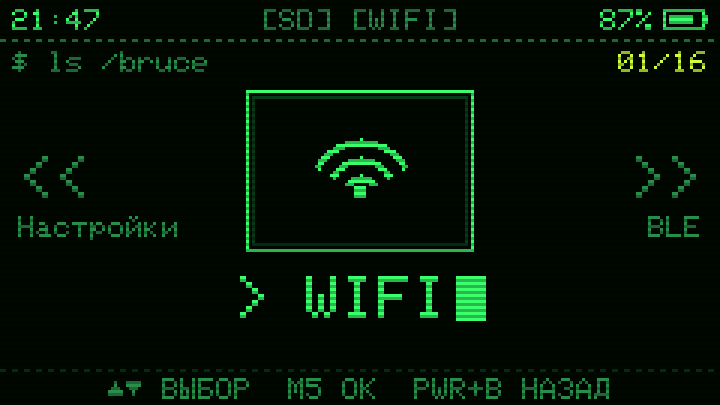
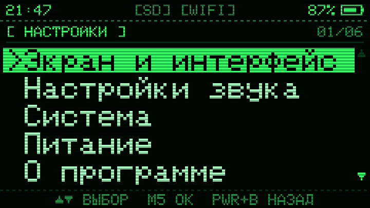
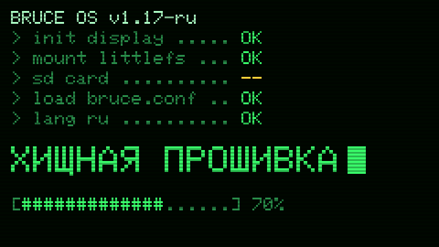
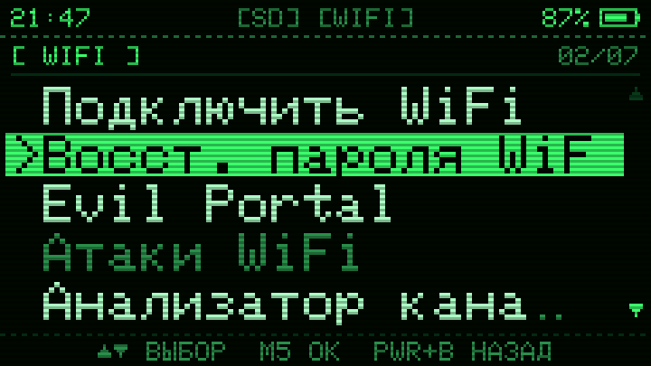
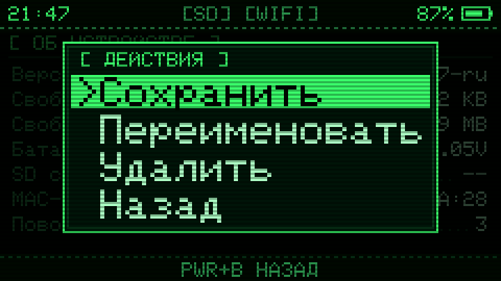
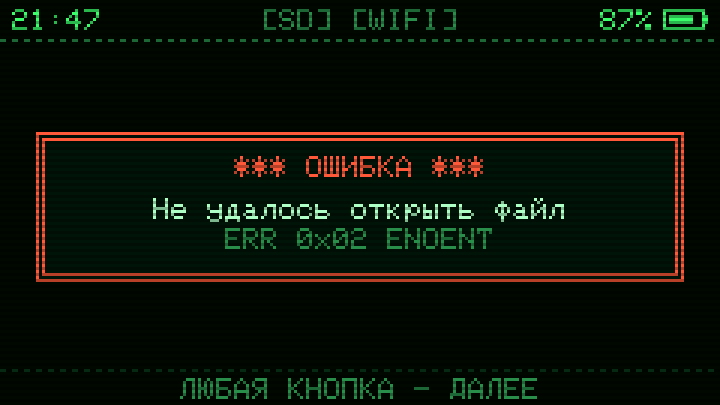
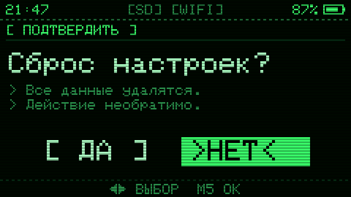
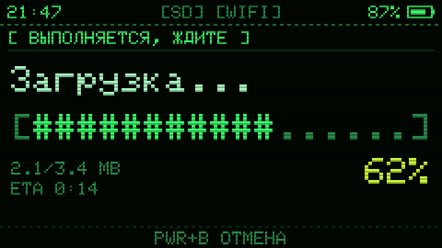

<div align="center">



<p>
  <a href="https://github.com/expl01t-search/bruce-ru/releases/latest"></a>
  <a href="https://github.com/expl01t-search/bruce-ru/actions/workflows/build.yml"></a>
  
  <a href="LICENSE"></a>
</p>

<a href="https://github.com/expl01t-search/bruce-ru/releases/latest"></a>
<a href="README.md"></a>

<br><br>




</div>


## `> what is it`

**Bruce RU** is a build of the open-source [Bruce](https://github.com/BruceDevices/firmware) 1.17 firmware for the **M5StickC Plus2** with:

| | |
|:--|:--|
| **Full Russian UI** | ~3000 strings: menus, messages, hints and titles. Cyrillic is baked into the built-in 5×8 font, so it costs no extra resources. Cyrillic file names and Wi‑Fi SSIDs render correctly too |
| **Fosfor interface** | A green phosphor-terminal look: status bar, main menu, inverse-highlight lists, toasts, dialogs, progress bars and a boot-log splash |
| **Upstream bug fixes** | Crashes in the `display start/stop/dump` serial commands, broken `printf` output, thread races and a sample-loss bug in the SUMP logic analyzer |
| **Toggles** | Language and style switch live in *Settings → Display & UI*. English and the classic Bruce look are one click away |

The translation layer is generic: a TSV dictionary compiled into a sorted table at build time, plus a font patch. It can be reused for **other Cyrillic languages** (Ukrainian, Belarusian, Kazakh, Serbian) — PRs welcome.

## `> screenshots`

<p align="center">
  
  
  
</p>
<p align="center">
  
  
  
</p>

## `> install`

Download `Bruce-m5stack-cplus2-ru.bin` from the [latest release](https://github.com/expl01t-search/bruce-ru/releases/latest) and flash it at `0x0`:

```powershell
pip install esptool
python -m esptool --chip esp32 --port COM5 --baud 921600 write-flash -z 0x0 Bruce-m5stack-cplus2-ru.bin
```

Device settings (LittleFS) are preserved.

**Controls:** `PWR` up, side `B` down, `M5` select, `PWR + B` back. Hold `PWR` for 3 s to power off.

<details>
<summary><b>Build from source</b></summary>

```bash
git clone --recurse-submodules https://github.com/expl01t-search/bruce-ru.git
cd bruce-ru
pip install platformio
pio run -e m5stack-cplus2
```

Translation internals: [tools/i18n/README.md](tools/i18n/README.md).

</details>


## `> responsible use`

Bruce is a tool for studying wireless protocols and testing **your own** devices and networks. Only use it where you are authorised to.

## `> credits`

Based on [Bruce](https://github.com/BruceDevices/firmware) by BruceDevices and contributors — original README in [README_BRUCE.md](README_BRUCE.md). License: [AGPL-3.0](LICENSE).
