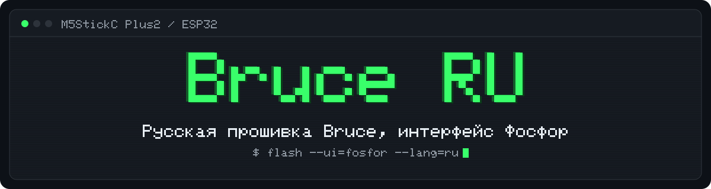
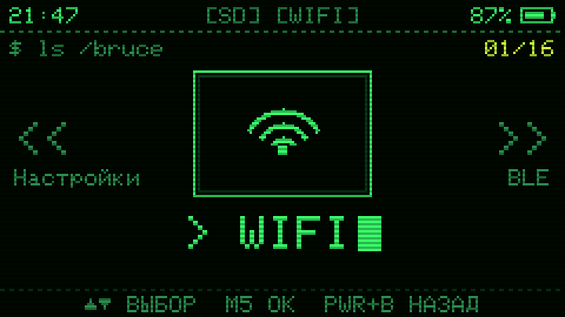
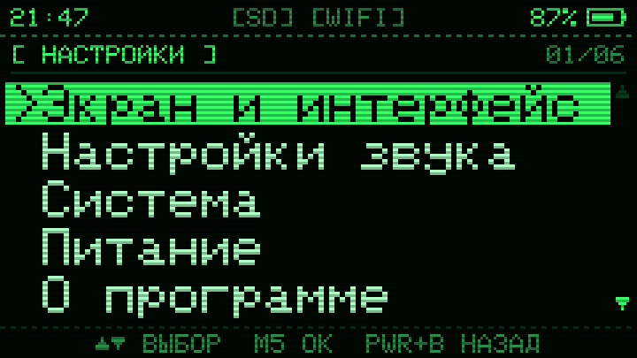
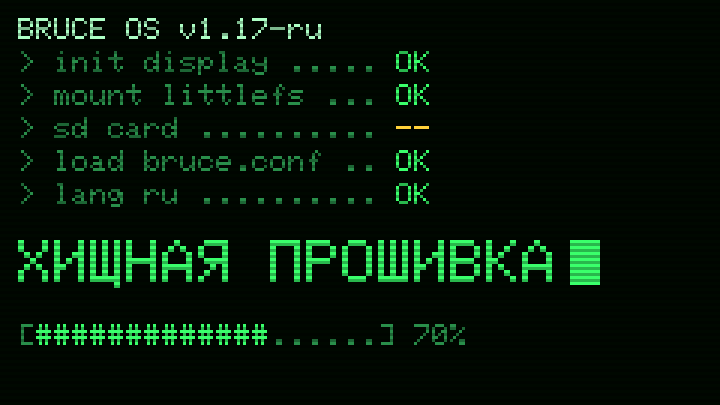
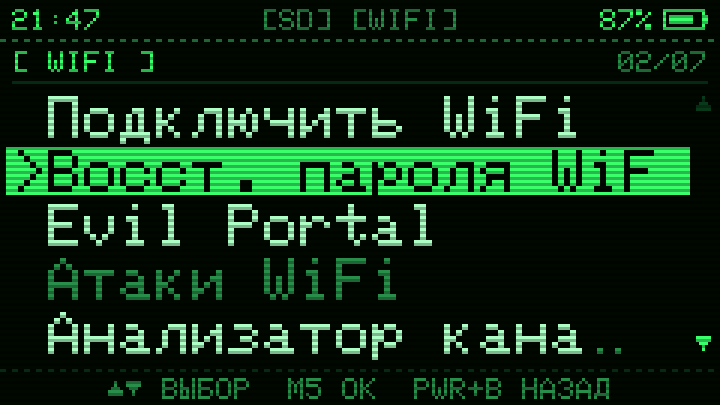
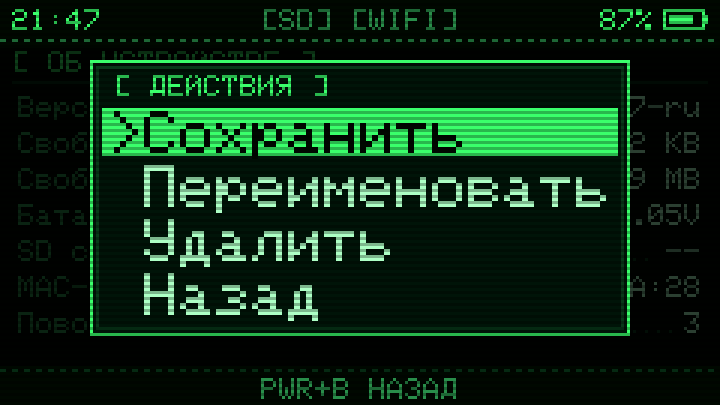
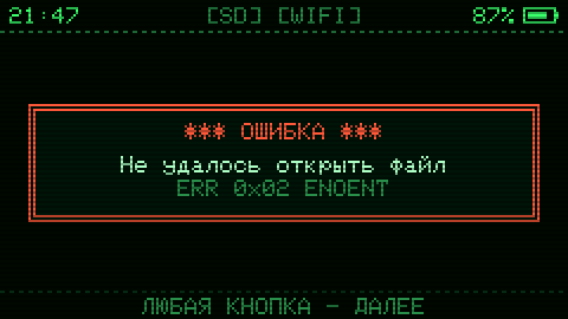
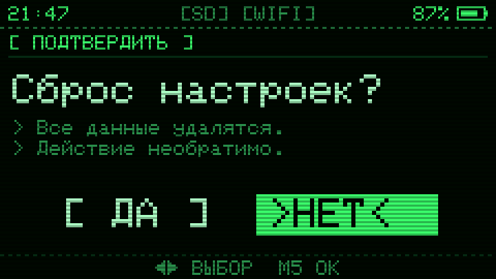
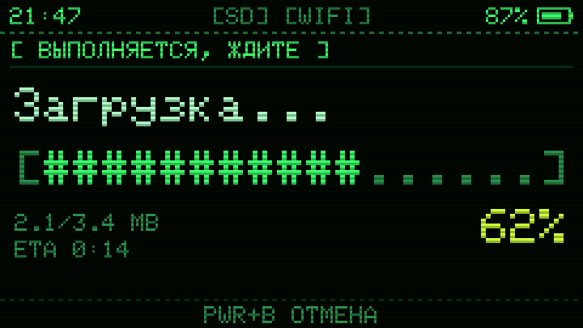

<div align="center">



<p>
  <a href="https://github.com/expl01t-search/bruce-ru/releases/latest"></a>
  <a href="https://github.com/expl01t-search/bruce-ru/actions/workflows/build.yml"></a>
  
  
  <a href="LICENSE"></a>
</p>

<a href="https://github.com/expl01t-search/bruce-ru/releases/latest"></a>
<a href="README.en.md"></a>

<br><br>




</div>


## `> что это`

**Bruce RU** — сборка открытой прошивки [Bruce](https://github.com/BruceDevices/firmware) 1.17 для **M5StickC Plus2**, в которой:

| | |
|:--|:--|
| **Русский язык** | Весь интерфейс — около 3000 строк: меню, сообщения, подсказки, заголовки. Кириллица добавлена прямо во встроенный шрифт, поэтому работает без лишних ресурсов. Русские имена файлов и сетей Wi‑Fi тоже отображаются |
| **Интерфейс «Фосфор»** | Новый вид в духе зелёного терминала: статус-бар, главное меню, списки с инверсным выделением, сообщения, диалоги, прогресс и заставка в виде лога загрузки |
| **Исправления** | Ошибки оригинала, из-за которых падали serial-команды (`display start/stop/dump`, вывод `printf`), гонки потоков и потеря данных в логическом анализаторе |
| **Переключатели** | Язык и стиль меняются в *Настройки → Экран и интерфейс*, без перезагрузки. Можно вернуть английский язык и классический вид Bruce |

## `> скриншоты`

<p align="center">
  
  
  
</p>
<p align="center">
  
  
  
</p>

<sub>Кадры 240×135, увеличены в 3 раза. Отрисованы тем же шрифтом, разметкой и цветами, что и прошивка (`tools/ui/fosfor_preview.py`).</sub>

## `> установка`

1. Скачай `Bruce-m5stack-cplus2-ru.bin` из [последнего релиза](https://github.com/expl01t-search/bruce-ru/releases/latest).
2. Подключи M5StickC Plus2 по USB-C и узнай номер COM-порта в Диспетчере устройств.
3. Прошей образ с адреса `0x0`:

```powershell
pip install esptool
python -m esptool --chip esp32 --port COM5 --baud 921600 write-flash -z 0x0 Bruce-m5stack-cplus2-ru.bin
```

Настройки на устройстве (раздел LittleFS) при этом сохраняются. При первом запуске включатся русский язык и стиль «Фосфор».

**Управление:** `PWR` — вверх, боковая `B` — вниз, `M5` — выбор, `PWR + B` вместе — назад. Удержание `PWR` 3 секунды выключает стик.

<details>
<summary><b>Сборка из исходников</b></summary>

```powershell
git clone --recurse-submodules https://github.com/expl01t-search/bruce-ru.git
cd bruce-ru
pip install platformio
python -m platformio run -e m5stack-cplus2
```

Готовый образ: `Bruce-m5stack-cplus2.bin` в корне проекта.
На Windows включи длинные пути для git: `git config --global core.longpaths true`.

</details>

<details>
<summary><b>Как устроены перевод и интерфейс</b></summary>

- **Шрифт:** 64 буквы кириллицы во встроенном шрифте TFT_eSPI 5×8 — `tools/i18n/cyrillic_glyphs.txt`, коды `0x80..0xBF`.
- **Перевод:** на лету при выводе на экран — `src/core/i18n.*`. Словарь — `tools/i18n/ru.d/*.tsv`, он собирается в `src/core/i18n_ru_data.h` при каждой сборке.
- **Фосфор:** `src/core/ui_fosfor.*`, спецификация и макеты — `tools/ui/fosfor_preview.py`.
- **Тесты:** `tools/i18n/test/`. Проверка на устройстве по USB: `python tools/i18n/device_check.py COM5 status screen`.

Подробности — [tools/i18n/README.md](tools/i18n/README.md).

</details>

<details>
<summary><b>Исправленные ошибки оригинального Bruce</b></summary>

- `USBSerial::vprintf` передавал `va_list` в вариадический `printf`: вместо чисел выводились адреса, на `%s` прошивка падала.
- `display stop` освобождал буфер лога экрана, пока в него писали (use-after-free), а `display start` терял память.
- `display dump` держал 8 КБ на стеке задачи serial-команд.
- Гонка при остановке трансляции экрана: отправка в уже удалённую очередь.
- Гонка потоков с названием меню между основным циклом и serial-командами.
- Логический анализатор (SUMP): переполнение счётчика буфера теряло все отсчёты, кроме последних 255.

</details>


## `> помочь проекту`

- ⭐ **Поставь звезду** — так репозиторий проще найти тем, кому он нужен.
- Нашёл **английскую строку** на экране или кривой перевод — открой [issue «Перевод»](https://github.com/expl01t-search/bruce-ru/issues/new?template=translation.yml), хватит фото экрана.
- Хочешь добавить свой язык на кириллице (украинский, белорусский, казахский…) или новую тему интерфейса — смотри [CONTRIBUTING.md](CONTRIBUTING.md).
- Вопросы и идеи — в [Discussions](https://github.com/expl01t-search/bruce-ru/discussions).

## `> важно`

Bruce — инструмент для исследования беспроводных протоколов и проверки **собственных** устройств и сетей. Используй его только там, где у тебя есть на это право: вмешательство в чужие сети и устройства незаконно.

## `> благодарности`

Основа — [Bruce](https://github.com/BruceDevices/firmware) от команды BruceDevices и всех его контрибьюторов. Оригинальный README — [README_BRUCE.md](README_BRUCE.md).
Лицензия — [AGPL-3.0](LICENSE), как у оригинала.
